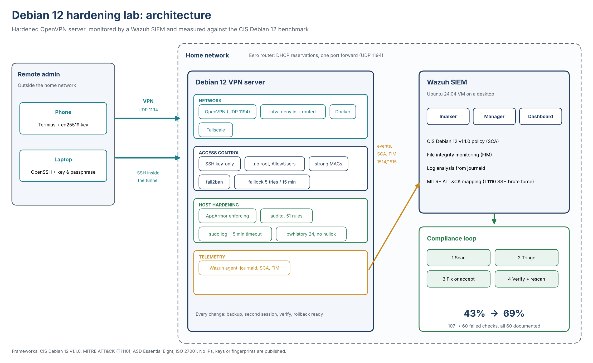
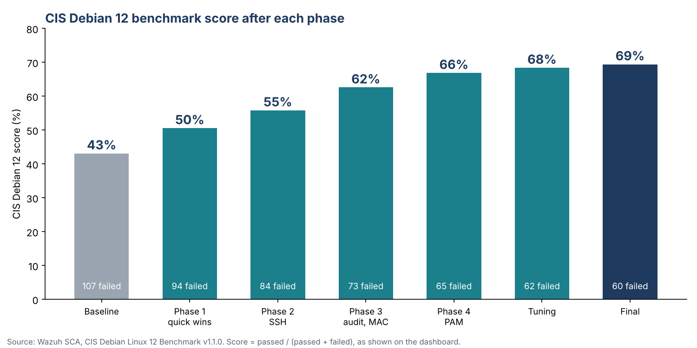
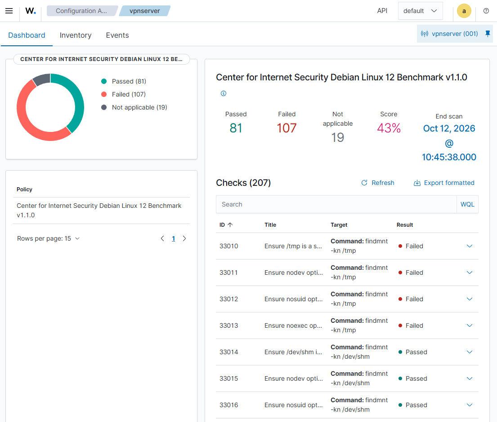
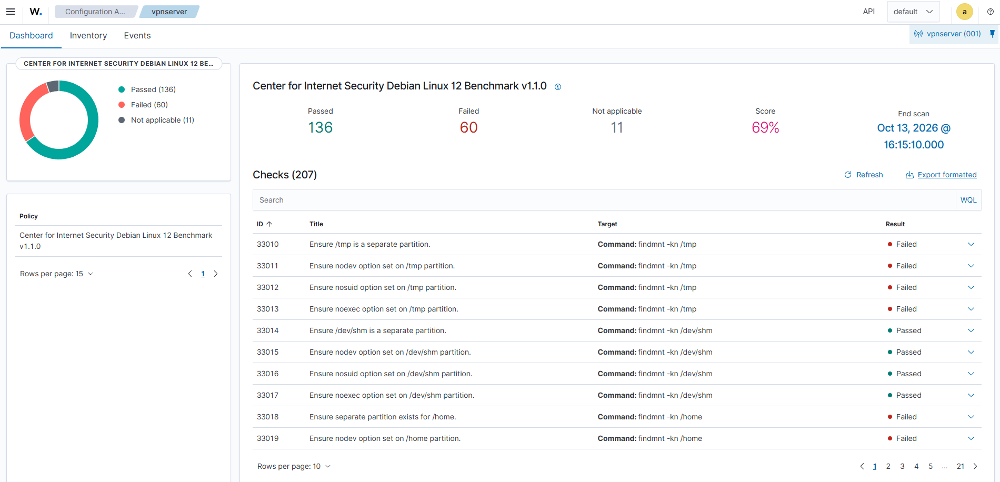

# Debian 12 hardening lab: SSH, Wazuh SIEM and the CIS benchmark

A home-lab project that hardens a Debian 12 OpenVPN server and measures the result with a SIEM.
I used the CIS Debian 12 Benchmark as the yardstick, fixed what was worth fixing, and wrote down
a reason for every check I chose not to fix, the way a GRC analyst would.

**Result: CIS score 43% to 69% (81 to 136 checks passed). Failed checks fell from 107 to 60, and all 60 have a written decision.**

## What this project shows

- **Hardening:** key-only SSH, PAM lockout and password policy, auditd, AppArmor, firewall review.
- **Detection and measurement:** Wazuh SIEM, CIS SCA policy, file integrity monitoring, log collection.
- **GRC:** a decision register (Fix, Accept risk, Investigate) with lockout risk and justification for every failed check.
- **Safe change practice:** backup, second session, verify, rollback, rescan.
- **Critical reading of tools:** 15 scanner rule defects identified and proven on the host, not blindly "fixed".

## Contents

| Document | What it covers |
|---|---|
| [`docs/architecture.md`](docs/architecture.md) | Components, data flows, trust boundaries |
| [`docs/threat-model.md`](docs/threat-model.md) | Assets, threats, controls, ATT&CK mapping, residual risk |
| [`docs/CIS_Debian12_Decision_Register.xlsx`](docs/CIS_Debian12_Decision_Register.xlsx) | Every failed check with decision, phase, lockout risk and justification |
| [`docs/evidence/`](docs/evidence/) | Wazuh dashboard screenshots for every scan |
| [`docs/lessons-learned.md`](docs/lessons-learned.md) | Scanner rule defects and how I proved them |
| [`docs/wazuh-usage.md`](docs/wazuh-usage.md) | What Wazuh is used for here, and next steps (vulnerability detection, active response) |
| [`docs/runbook-rollback.md`](docs/runbook-rollback.md) | Change procedure and rollback per phase |
| [`docs/frameworks-mapping.md`](docs/frameworks-mapping.md) | Essential Eight, ISO 27001 Annex A and MITRE ATT&CK |
| [`configs/`](configs/) | Sanitized configuration files |

## Environment

| Item | Detail |
|---|---|
| Target | Debian 12 (OpenSSH 9.2, systemd journal), OpenVPN gateway, also runs Docker and Tailscale |
| SIEM | Wazuh 4.14 all-in-one on an Ubuntu 24.04 VM (VMware Workstation) |
| Benchmark | CIS Debian Linux 12 Benchmark v1.1.0 through the Wazuh SCA module |
| Admin access | Termius (iOS) and OpenSSH, ed25519 keys with passphrase, used through the VPN |

## Results by phase

| Step | Passed | Failed | Score |
|---|---|---|---|
| Baseline | 81 | 107 | 43% |
| Phase 1: quick wins | 96 | 94 | 50% |
| Phase 2: SSH | 106 | 84 | 55% |
| Phase 3: auditd and AppArmor | 122 | 73 | 62% |
| Phase 4: passwords and PAM | 131 | 65 | 66% |
| Tuning | 134 | 62 | 68% |
| Final | 136 | 60 | 69% |

## Evidence

Wazuh dashboard, before and after. All scans are in [`docs/evidence/`](docs/evidence/).

| Baseline (43%) | Final (69%) |
|---|---|
|  |  |

## What I changed

| Phase | Area | Main changes |
|---|---|---|
| 0 | SSH basics | Key-only login (ed25519 with passphrase), no root login, no password login, fail2ban on the systemd journal |
| 1 | Quick wins | Login banner, sudo logging and timeout, `/dev/shm` noexec, removed telnet client and bluetooth, removed motd |
| 2 | SSH | `AllowUsers`, `MaxAuthTries 4`, `LoginGraceTime 60`, client keepalive, `DisableForwarding`, strong MACs only |
| 3 | Auditing and MAC | AppArmor enforcing, auditd with a CIS rule set (identity, sudo, time, mounts, deletions, modules), larger backlog |
| 4 | Passwords and PAM | `pam_faillock` (5 tries, 15 min lock), `pam_pwhistory` (24 remembered, enforced for root), no `nullok`, password ageing |
| 5 | Firewall | `ufw` already default-deny for incoming and routed traffic; outbound policy reviewed and recorded as an accepted risk |

Sanitized configs are in [`configs/`](configs/). Replace the `<placeholders>` with your own values.

## Decisions worth reading

- **Outbound default-deny (ufw, check 33132): accepted.** The server is a VPN gateway that also runs
  Docker and Tailscale. Blocking egress would break updates, DNS, NTP and the Wazuh agent for little gain.
  Inbound and routed traffic stay on deny.
- **SSH left open in ufw: accepted.** It is key-only, limited by `AllowUsers`, protected by fail2ban,
  and not port-forwarded on the router. Closing it would risk a lockout when travelling.
- **sudo timeout kept at 5 minutes (check 33181): deliberate deviation.** Stricter than the scan expects.
- **Chrony instead of systemd-timesyncd (check 33094): accepted.** CIS allows only one time service.
- **Wazuh syscheck instead of AIDE (checks 33284, 33285):** equivalent control, no duplicate tooling.
- **Halting the server when audit logs fill (checks 33250 to 33252): accepted.** It would take a headless VPN gateway offline.

## Why the score is not 100%

The score counts every check equally. Of the 60 remaining failures: 22 are separate-partition checks that
add little on a small single-purpose server, 11 are `nftables` and `iptables` checks that do not apply because
the host uses `ufw`, 15 are defects in the scanner rule itself, 9 are met by an equivalent control, and 3 are
availability trade-offs. Details are in the decision register and `docs/lessons-learned.md`.

## Lessons learned

1. **The scanner is not always right.** Fifteen failed checks were defects in the SCA policy itself, for
   example a regex written as `(d+)` instead of `(\d+)`, or a rule that expects `-C euid!=uid` when
   `auditctl` always prints `-C uid!=euid`. I verified each one on the host and recorded it as accepted.
2. **Check before you apply.** Setting password expiry on an account whose password was 15 months old
   would have locked me out. I changed the password first, then applied `chage`.
3. **Test the lockout paths.** Every risky phase had a second SSH session open, a backup of the files
   touched, and a rollback command ready.
4. **A removal list in `sshd_config` is not forgiving.** My per-item `-` list for MACs silently did
   nothing. A positive allow-list worked and I confirmed it with `sshd -T`.

## Roadmap

- Enable Wazuh vulnerability detection and add the findings to the register.
- Collect `auditd` logs in Wazuh and write custom rules for sudo and identity changes.
- Test active response against repeated SSH failures and compare it with fail2ban.
- Run a controlled brute-force test and show the T1110 detection in the dashboard.
- Egress allow-list for the VPN gateway.

## Frameworks

ASD Essential Eight, ISO/IEC 27001:2022 Annex A and MITRE ATT&CK. See
[`docs/frameworks-mapping.md`](docs/frameworks-mapping.md).

## Related project

[failed-login-detector](https://github.com/Jechu23/failed-login-detector): a Python script that
parses SSH failed-login events from the same server's journal.

## Security note

This repository contains no keys, IP addresses, host fingerprints or credentials. Configs use
placeholders. Do not copy the PAM or SSH settings onto a production system without testing
a rollback path first.

## Licence

MIT. See [`LICENSE`](LICENSE).
